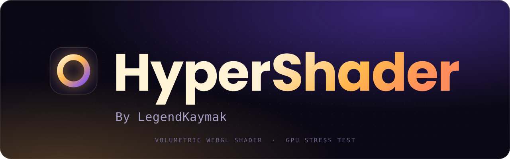
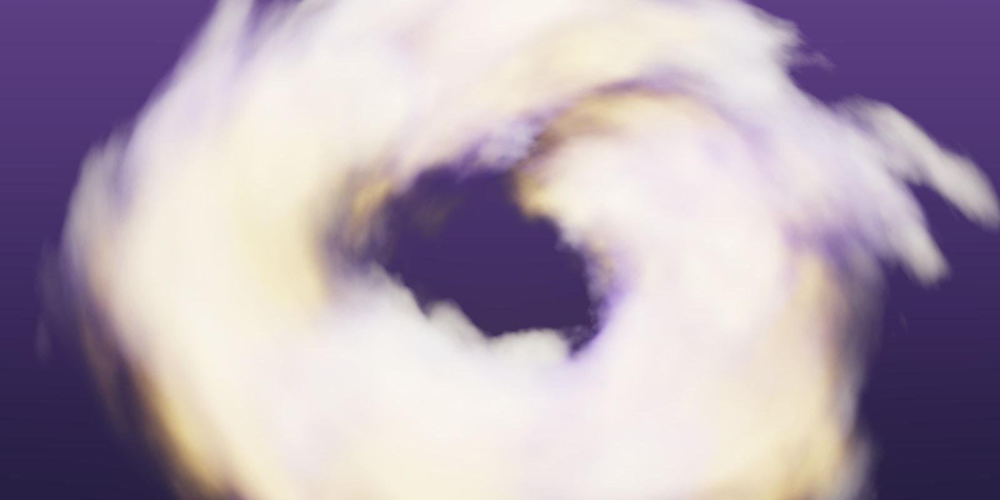

<h3>A volumetric WebGL shader built to push your GPU to its limit.</h3>

  
  
  
  
  

  <a href="https://legendkaymak.github.io/HyperShader/"><b>Launch HyperShader</b></a>
  &nbsp;·&nbsp;
  <a href="#load-levels">Load levels</a>
  &nbsp;·&nbsp;
  <a href="#controls">Controls</a>
  &nbsp;·&nbsp;
  <a href="#türkçe">Türkçe</a>

> [!WARNING]
> HyperShader is a stress test. It can heat up your device, drain the battery fast and freeze the browser for a few seconds. Read the on-page disclaimer before you start. You use it entirely at your own risk.

  
   
  Still frame at Crushing quality: 384 ray steps and 32 shadow steps per pixel.

## Features

- **Real-time volumetric raymarching.** A twisting ring of fractal smoke, lit by an orbiting light with a shadow ray at every step.
- **Five load levels**, from a gentle Warm-up to Beyond.
- **Beyond mode.** Every screen pixel is built from 64 samples (8× in each direction), rendered tile by tile. If the graphics driver resets, it recovers on its own with smaller tiles instead of closing.
- **Live stats.** FPS with a sparkline, frame time, render resolution and noise calls per frame.
- **Orbit the camera** by dragging. Double-click to turn auto-rotate back on.
- **PNG screenshots** straight from the canvas.
- **English and Turkish interface.** The page remembers your language and last level.
- **Safety first.** A detailed disclaimer and three consent boxes come before anything renders.
- **One self-contained `index.html`.** No build step, no libraries. Only the fonts come from Google Fonts.

## Load levels

| Level | Ray steps | Shadow steps | Noise octaves | Render resolution |
| :-- | --: | --: | --: | :-- |
| Warm-up | 96 | 8 | 4 | 0.6× screen |
| Heavy | 192 | 16 | 6 | 1× screen |
| Crushing | 384 | 32 | 8 | Native (Retina) pixels |
| Doomsday | 512 | 48 | 8 | 1.5× native pixels |
| **Beyond** | 512 | 48 | 8 | **8× supersampling, tiled** |

Each shadow step samples the full noise field again, so the cost grows with ray steps × shadow steps × octaves × pixels. Doomsday alone runs billions of noise calls per frame on a 1080p screen. Beyond takes minutes for a single frame on most GPUs.

## Controls

| Input | Action |
| :-- | :-- |
| <kbd>Esc</kbd> | Stop and return to the start screen |
| <kbd>Space</kbd> | Pause or resume |
| <kbd>1</kbd> – <kbd>5</kbd> | Switch load level |
| <kbd>F</kbd> | Toggle fullscreen |
| Drag | Orbit the camera |
| Double-click | Turn auto-rotate back on |

## How it works

Each pixel casts a ray into a bounding sphere and marches up to 512 steps through a density field: a torus twisted around its own axis, eroded by up to 8 octaves of fractal noise and a slow trigonometric wobble. Wherever the ray hits smoke, a second march of up to 48 steps toward the light measures how much smoke is in the way, which gives the soft self-shadowing. Colour is accumulated front to back with Beer–Lambert absorption, then tone-mapped with ACES and gamma corrected.

Beyond renders 256 × 256 tiles of a virtual 8×-resolution image into a small offscreen framebuffer. Each 8 × 8 block is averaged in linear light into one screen pixel. The number of tiles per frame adapts to how fast your GPU answers, so the browser stays responsive while the frame fills in from the centre outwards.

## Run it yourself

- **Locally:** download `index.html` and open it in a browser.
- **GitHub Pages:** fork the repo, then go to *Settings → Pages* and deploy from the `main` branch, root folder.

You need a browser with WebGL 1.0. A desktop GPU is recommended. Phones and tablets work fine on the lower levels.

## Disclaimer

HyperShader is provided "as is", without warranty of any kind. To the maximum extent permitted by law, the author accepts no liability for any damage to hardware, loss of data or personal injury arising from its use. The full terms are shown on the start screen and must be accepted before the shader runs.

## License

[MIT](LICENSE) © 2026 LegendKaymak

---

## Türkçe

<b>Türkçe açıklamayı göster</b>

 

**HyperShader**, ekran kartını sonuna kadar zorlamak için yapılmış hacimsel bir WebGL shader'ıdır.

> [!WARNING]
> HyperShader bir stres testidir. Cihazı ısıtabilir, pili hızla bitirebilir ve tarayıcıyı birkaç saniye dondurabilir. Başlamadan önce sayfadaki sorumluluk reddini oku. Kullanım tamamen kendi sorumluluğundadır.

**Özellikler**

- Gerçek zamanlı hacimsel ışın yürütme: dönen bir halka şeklinde fraktal duman ve her adımda gölge hesabı
- Isınma'dan Kıyamet Ötesi'ne beş yük seviyesi
- Kıyamet Ötesi: her ekran pikseli 64 örnekten oluşur, görüntü parça parça işlenir; grafik sürücüsü sıfırlanırsa kapanmaz, kendi kendine toparlanır
- Canlı FPS grafiği, kare süresi, çözünürlük ve kare başına gürültü çağrısı
- Sürükleyerek kamerayı döndürme, PNG ekran görüntüsü
- İngilizce ve Türkçe arayüz
- Tek bir `index.html` dosyası, derleme gerekmez

**Seviyeler:** Isınma · Ağır · Ezici · Kıyamet · Kıyamet Ötesi

**Kısayollar:** <kbd>Esc</kbd> durdur · <kbd>Boşluk</kbd> duraklat · <kbd>1</kbd>–<kbd>5</kbd> seviye · <kbd>F</kbd> tam ekran · Sürükle: döndür · Çift tık: otomatik dönüş

**Çalıştırma:** `index.html` dosyasını tarayıcıda aç ya da [canlı sürümü](https://legendkaymak.github.io/HyperShader/) kullan.

**Lisans:** [MIT](LICENSE) © 2026 LegendKaymak

Made by <b>LegendKaymak</b>

